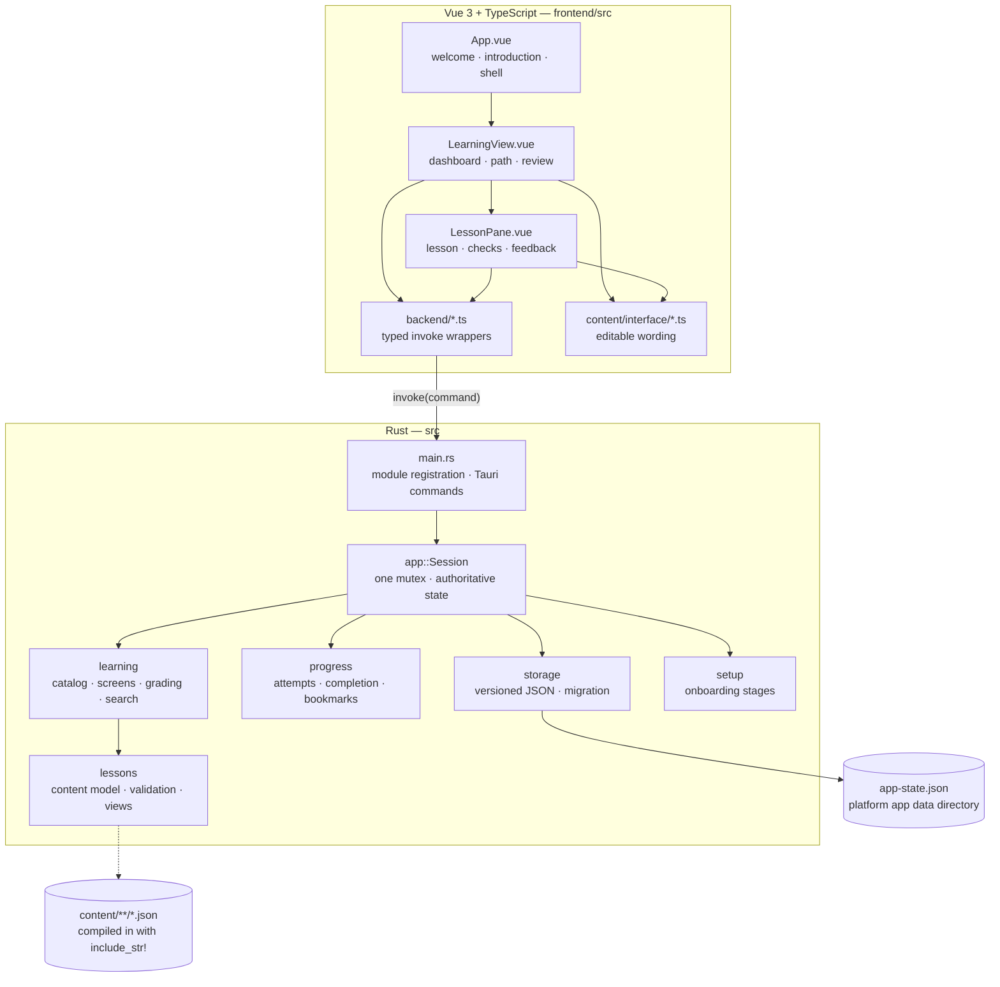

# New Bearings

A Rust-first desktop learning application built with Tauri 2, Vue 3 and
TypeScript. It teaches short, structured lessons, checks understanding with
three kinds of question, remembers what you have answered, and keeps everything
on your own computer.

New Bearings is an early-stage project, but it is a working one: you can start
from scratch, work through a learning path, get feedback on wrong answers, come
back to the questions that caught you out, and close the application knowing the
progress survived.

- **Rust decides everything that matters.** Onboarding rules, the content model
  and its validation, the learner's position, answer grading, the completion
  rule, the review queue, bookmarks, search and persistence are all Rust.
- **Vue renders what Rust reports.** Components receive snapshots and draw them;
  they do not decide what is allowed or what is correct.
- **No account, no network.** There is no sign-up, no telemetry and no HTTP
  client in the application.

---

## Contents

1. [Status](#status)
2. [What the application does](#what-the-application-does)
3. [Quick start](#quick-start)
4. [Architecture](#architecture)
5. [How a request flows](#how-a-request-flows)
6. [Learning content](#learning-content)
7. [Progress, review and bookmarks](#progress-review-and-bookmarks)
8. [Where your data lives](#where-your-data-lives)
9. [Project structure](#project-structure)
10. [Development workflow](#development-workflow)
11. [Testing and CI](#testing-and-ci)
12. [Accessibility](#accessibility)
13. [Privacy](#privacy)
14. [Known limitations](#known-limitations)
15. [Documentation index](#documentation-index)
16. [Licence](#licence)

---

## Status

Status labels used below mean:

- **Verified** — implemented and exercised in this session, in the real desktop
  window or by an automated test that asserts the behaviour.
- **Implemented** — present in the code with unit tests, but not driven through
  the interface in this session.
- **Planned** — not implemented; do not expect it.

| Area | State | Notes |
| --- | --- | --- |
| Application startup (Windows) | Verified | `tauri dev` launches, the window renders, the Rust session is created before the UI loads. |
| Welcome and introduction | Verified | Two onboarding screens; Rust owns the stage and rejects invalid transitions. |
| Learning dashboard | Verified | Real totals, resume card, review callout, search and path cards. |
| Path view | Verified | Lesson list with completion, in-progress, mistake counts and bookmark toggles. |
| Lesson reader | Verified | Explanation, code, note, numbered steps, comparison table and common-mistake blocks. |
| Learning objectives | Verified | Listed at the top of every lesson; required by content validation. |
| Multiple-choice checks | Verified | Graded in Rust; the answer never leaves the backend. |
| True/false checks | Verified | Two labelled options, same grading boundary. |
| Short-answer checks | Verified | Normalized comparison against authored wordings; empty input is rejected, not marked wrong. |
| Answer feedback | Verified | Correct/incorrect label plus the authored explanation. A wrong answer keeps the question open for another attempt. |
| Lesson completion | Verified | Only when every check has been answered correctly; opening a lesson does not complete it. |
| "Continue learning" | Verified | Returns to the most recently opened unfinished lesson, falling back to the first unfinished one. |
| Progress persistence | Verified | Saved after every attempt and stage change; survives a full process restart. |
| Schema migration | Verified | A version 1 progress file is converted in place to version 2 and keeps its completions. |
| Review queue | Verified | Lessons containing at least one wrong answer, ordered by mistakes then recency. |
| Bookmarks | Verified | Per-lesson; survive restart; counted on the dashboard. |
| Search | Verified | Rust-side search over path titles, summaries, subjects and tags, and lesson titles, summaries and objectives. |
| Data recovery | Implemented | Unreadable files are moved aside as `app-state.recovered-<timestamp>.json` and reported. Tested in Rust. |
| Reduced motion, focus, live regions | Verified | `prefers-reduced-motion` honoured; visible focus rings; results announced with `role="status"`. |
| Linux and macOS | Implemented | Both compile and pass tests in CI; the interface has not been run on them here. |
| Accounts, sync, cloud | Planned | Not implemented, and not required to use the application. |
| Spaced repetition scheduling | Planned | The review queue is mistake-driven, not time-driven. |
| Content import or editor | Planned | Content is JSON compiled into the build. |
| Installers, signing, updates | Planned | `bundle.active` is `false`; no installer is produced. |

At the time of writing, `cargo test` reports **115 passing tests**.

---

## What the application does

### First run

1. **Welcome** invites you to begin.
2. **Introduction** explains the idea and offers *Start learning* or *Back to
   welcome*.
3. **Dashboard** lists the installed paths with real progress, and a search box.

### Learning

Each path is an ordered set of lessons. A lesson opens with its objectives, then
the teaching material, then its knowledge checks.

Three kinds of check appear:

| Kind | Interaction | Grading |
| --- | --- | --- |
| `choice` | Pick one of two or more options | The selected index is compared with the authored answer in Rust. |
| `trueFalse` | Choose *True* or *False* | The chosen boolean is compared in Rust. |
| `shortAnswer` | Type an answer | Compared with the authored accepted wordings after trimming, lower-casing, collapsing whitespace and ignoring a trailing full stop. An empty answer is rejected with a message rather than counted as wrong. |

Every check carries an explanation that is shown only after an attempt. On a
wrong answer the question stays open, the mistake is recorded for review, and the
explanation is shown. On a correct answer the check closes and the answer is
remembered, so reopening the lesson later shows it as solved instead of asking
again.

### Progress and review

- A lesson is **complete** only when all of its checks have been answered
  correctly. Merely opening it changes nothing except the resume pointer.
- The dashboard shows lessons completed, checks solved, minutes of completed
  lessons, saved lessons, a progress bar per path, and a review callout when any
  wrong answers exist.
- **Review** lists every lesson with at least one wrong answer, most mistakes
  first. Completed lessons stay in the list, because a question you once missed
  is still worth another look.
- **Bookmarks** save a lesson for later from the path list, the review list or
  the lesson itself.

---

## Quick start

Requirements:

- Rust stable (the project uses edition 2024).
- Node.js 20 or newer with npm.
- Tauri's platform prerequisites: on Windows, WebView2 (already present on
  Windows 11) and the MSVC build tools; on Debian/Ubuntu the packages listed in
  [Development workflow](#development-workflow).

```bash
git clone https://github.com/Pandagamerteen08/New-Bearings.git
cd New-Bearings
npm --prefix frontend install
./frontend/node_modules/.bin/tauri.cmd dev    # Windows
./frontend/node_modules/.bin/tauri dev        # macOS / Linux
```

The Tauri CLI starts Vite on `http://localhost:5173`, compiles the Rust binary
and opens the window. There is no separate server to run.

More detail, including how to produce a plain executable, is in
[docs/INSTALLATION.md](docs/INSTALLATION.md).

---

## Architecture

Rust owns the application; Vue renders it.



Key decisions:

- **One lock, one state.** `app::Session` holds the setup stage, the current
  learning screen, all progress and the storage handle behind a single `Mutex`.
  Commands lock it, mutate, persist and build a snapshot. There is no second
  source of truth and no lock ordering to get wrong.
- **Answers cannot leak.** `lessons::Check` is not serializable. The interface
  receives `CheckView`, which has no answer, explanation or accepted-answer
  field; a test asserts those keys never appear in a serialized lesson.
- **Screens are Rust state.** `learning::Screen` is a tagged enum
  (`dashboard`, `review`, `path`, `lesson`). The interface cannot show a screen
  Rust did not select, and `go_back` is a rule, not a history stack.
- **Content is compiled in.** Packs are `include_str!`-ed and validated on first
  use; a failure is a build defect, reported as `content_invalid`.
- **Money-free, network-free, account-free.** No HTTP client, no telemetry, no
  credentials.

---

## How a request flows

Answering a knowledge check, end to end:

1. `LessonPane.vue` packs the learner's input into a `SubmittedAnswer`
   (`{ kind: 'choice', option }`, `{ kind: 'trueFalse', value }` or
   `{ kind: 'shortAnswer', text }`).
2. `frontend/src/backend/learning.ts` calls
   `invoke('submit_lesson_answer', { pathId, lessonId, checkId, answer })`.
3. `src/main.rs` forwards to `Session::submit_answer`.
4. `learning::evaluate_answer` finds the lesson and check, and calls
   `Check::grade`. A malformed answer is rejected here (`answer_mismatch`,
   `option_out_of_range`, `empty_answer`) rather than scored.
5. `ProgressState::record_attempt` updates that check's attempt and mistake
   counters and, if every check is now correct, sets the completion time once.
6. `Inner::persist` writes `app-state.json` through a temporary file and a
   rename. A failed write becomes a warning on the snapshot, never silent data
   loss.
7. `LearningSnapshot::build` recomputes the paths, the open lesson (with each
   check's solved state), the resume point, the totals and the review queue.
8. The outcome returns to Vue, which replaces its snapshot and re-renders.

Opening a lesson follows the same path without step 4, and additionally records
the lesson as the resume point.

---

## Learning content

Two packs ship today:

| Pack | Subject | Path | Lessons | Checks |
| --- | --- | --- | --- | --- |
| `content/programming/rust/foundations.json` | Programming | Rust Foundations | 4 | 12 |
| `content/web/fundamentals.json` | Web development | How the Web Works | 3 | 9 |

A pack is a JSON document with a format version, and paths containing lessons
containing sections and checks. Sections may be `explanation`, `code`, `note`,
`steps`, `table` or `mistake`; checks may be `choice`, `trueFalse` or
`shortAnswer`. Lesson objectives are required.

Rust validates every pack before use and reports **all** problems with a
location such as `paths[0].lessons[1].checks[0].answer`. Duplicate ids, blank
text, empty sections, missing objectives, table rows that do not match their
columns, and answer indexes outside the offered options are all rejected. The
bundled content is checked by tests, so a broken pack fails `cargo test`.

The exact schema and grading rules are documented in
[docs/CONTENT_FORMAT.md](docs/CONTENT_FORMAT.md). Adding a pack means adding one
line to `EMBEDDED_PACKS` in [src/learning/learning.rs](src/learning/learning.rs)
and re-running the tests.

---

## Progress, review and bookmarks

Progress is stored per lesson as:

- a map of check id → `{ attempts, mistakes, correct, lastAttemptAt }`;
- `completedAt`, set once, when the last check became correct;
- bookmarks, a set of `path/lesson` ids;
- `lastOpened`, the lesson to resume.

From that, Rust derives:

- **completion** — all checks of the lesson are correct;
- **in progress** — some answer has been submitted but the lesson is unfinished;
- **review** — any check has `mistakes > 0`, ordered by mistakes then recency;
- **totals** — lessons and checks solved, minutes of completed lessons, saved
  lessons.

Nothing is inferred that is not recorded: there are no streaks, no time-on-task
measurements and no mastery percentages.

---

## Where your data lives

One JSON file in the platform application data directory:

| Platform | Path |
| --- | --- |
| Windows | `%APPDATA%\com.newbearings.desktop\app-state.json` |
| macOS | `~/Library/Application Support/com.newbearings.desktop/app-state.json` |
| Linux | `~/.local/share/com.newbearings.desktop/app-state.json` |

The current schema version is **2**. A version 1 file is migrated in place (its
correct answers become single successful attempts and its completion times are
kept) and rewritten in the new shape. A file from an unknown newer version, or
one that cannot be parsed, is moved aside as
`app-state.recovered-<timestamp>.json` and the learner is told, instead of being
deleted.

Saving writes `app-state.json.tmp`, flushes it, and renames it over the real
file, so a crash mid-save cannot truncate progress.

To reset progress deliberately, delete that file while the application is
closed.

---

## Project structure

```text
src/                        Rust application (the decision layer)
  main.rs                   module registration, Tauri command surface, startup
  app/app.rs                application identity and re-exports
  app/session.rs            authoritative state, command logic, persistence
  setup/setup.rs            onboarding stages and legal transitions
  lessons/lessons.rs        content model, validation, answer-safe views, grading
  learning/learning.rs      catalog, screens, snapshots, search, review queue
  progress/progress.rs      attempts, completion rule, bookmarks, v1 migration
  storage/storage.rs        versioned JSON, atomic writes, recovery
content/                    learning content and interface wording
  programming/rust/         Rust Foundations pack
  web/                      How the Web Works pack
  interface/                editable UI wording (TypeScript)
frontend/                   Vue 3 + TypeScript interface
  src/App.vue               welcome, introduction, application shell
  src/components/           LearningView.vue, LessonPane.vue
  src/backend/              typed wrappers for the Tauri commands
  index.html, vite.config.ts, tsconfig*.json
docs/                       architecture, content format, testing, roadmap, policies
scripts/                    small PowerShell helpers for build, run and checks
icons/, resources/          generated icon set and its SVG source
gen/schemas/                Tauri-generated capability schemas (checked in)
tests/                      reserved directories for future fixture-based tests
.github/workflows/ci.yml    continuous integration
```

Every tracked file is described individually in
[docs/FILE_REFERENCE.md](docs/FILE_REFERENCE.md), including generated files and
the template leftovers that are not used.

---

## Development workflow

Run everything from the repository root.

```bash
# Install frontend dependencies (once, and after dependency changes)
npm --prefix frontend install

# Run the desktop application with hot reload
./frontend/node_modules/.bin/tauri.cmd dev      # Windows
./frontend/node_modules/.bin/tauri dev          # macOS / Linux

# Rust checks, in the order CI runs them
cargo fmt --check
cargo check --all-targets
cargo test
cargo clippy --all-targets -- -D warnings

# Frontend type-check and production build
npm --prefix frontend run build

# Compile the executable without starting the interface
npm --prefix frontend run build
cargo build
```

Notes:

- `tauri.conf.json` runs the frontend build from `frontend/`, so `cargo build`
  expects `frontend/dist` to exist. Build the frontend first.
- The PowerShell helpers under `scripts/` wrap the same commands:
  `scripts/test.ps1` runs formatting, compilation, tests, Clippy and the
  frontend build; `scripts/build.ps1` compiles the executable; `scripts/run.ps1`
  starts the development application; `scripts/setup-dev.ps1` checks that the
  toolchain is present.
- On Debian/Ubuntu, Tauri needs system libraries:

  ```bash
  sudo apt-get install build-essential pkg-config libssl-dev libgtk-3-dev \
    libwebkit2gtk-4.1-dev libayatana-appindicator3-dev librsvg2-dev libxdo-dev
  ```

Bundling is disabled (`bundle.active: false`), so no installer is produced.

---

## Testing and CI

| Layer | What it covers | How to run |
| --- | --- | --- |
| Rust unit tests (115) | Setup transitions, content validation and grading for all three check kinds, completion and mistake rules, resume selection, review ordering, bookmarks, search, snapshot shape, storage round-trips, corrupt data, schema migration, restart persistence. | `cargo test` |
| Serialization contract | Tagged screen shapes and camelCase keys the interface depends on, and the absence of answer keys in lesson views. | `cargo test` |
| Frontend build | Type-checks every component, wrapper and content file, then builds with Vite. | `npm --prefix frontend run build` |
| Runtime | The real desktop window driven through the WebView2 DevTools protocol: onboarding, reading, wrong and right answers, all three check kinds, completion, review, bookmarks, search, empty and disabled states, process restart, and a real version 1 → 2 migration. | manual; see below |
| Continuous integration | Rust checks on Windows, Ubuntu and macOS, plus the frontend build. | `.github/workflows/ci.yml` |

Runtime verification is not automated in the repository. If you want to repeat
it, launch with `WEBVIEW2_ADDITIONAL_BROWSER_ARGUMENTS=--remote-debugging-port=9333`
and drive the page through `http://127.0.0.1:9333/json/list`. The checks used in
this session covered more than sixty assertions across first run, the full
learning flow, the second path, review, search, bookmarks and a restart.

The CI workflow runs four jobs:

1. **Windows** — format, compile, test, Clippy.
2. **Ubuntu** — installs Tauri's system libraries, then the same four checks.
3. **macOS** — the same four checks.
4. **Frontend** — `npm ci` then `npm run build` on Ubuntu.

If compilation fails on a platform, the workflow republishes the matching log
lines as annotations so the failing message is visible in the run summary.

---

## Accessibility

- Semantic controls: native buttons, `<fieldset>`/`<legend>` per question,
  labelled radio inputs, a labelled text input, and scope-annotated table
  headers.
- Keyboard reachable throughout, with a visible focus ring
  (`:focus-visible`).
- Results are announced through `role="status"`; errors use `role="alert"`.
- State is never conveyed by colour alone: completed lessons say "Complete",
  mistakes are counted in words, and answer results carry a label.
- `prefers-reduced-motion` disables transitions and animations.
- Layout reflows to a single column on narrow windows.

See [ACCESSIBILITY.md](ACCESSIBILITY.md) for the project's broader intentions.

---

## Privacy

The application has no network code, no accounts, no analytics and no
crash reporting. Everything it knows is the JSON file described above, on the
machine that wrote it. Deleting that file removes all learner data.

See [PRIVACY_POLICY.md](PRIVACY_POLICY.md) and
[docs/PRIVACY_AND_DATA_HANDLING.md](docs/PRIVACY_AND_DATA_HANDLING.md).

---

## Known limitations

- **Two paths, seven lessons.** The catalog demonstrates the model rather than
  covering a curriculum.
- **No spaced repetition.** The review list is driven by recorded mistakes, not
  by time since practice.
- **No in-lesson navigation.** A lesson is a single scroll; there are no
  per-section anchors or collapsible blocks.
- **Search covers metadata, not prose.** Titles, summaries, subjects, tags and
  objectives are searched; section bodies are not.
- **Search is submitted, not live.** Results appear when the form is submitted,
  which keeps the backend in charge but is less immediate than filtering as you
  type.
- **No settings screen.** Theme, font size and similar preferences are not
  configurable; the interface follows the system's reduced-motion setting only.
- **No content authoring or import.** Adding content means editing JSON and
  rebuilding.
- **Windows is the only platform exercised at runtime here.** Linux and macOS
  compile and pass tests in CI, but the window has not been run on them.
- **No installers.** `bundle.active` is `false`; there is no signed package or
  auto-update.
- **`LICENSE` is still placeholder text** while `Cargo.toml` declares MIT. This
  has deliberately not been changed, because the licence choice belongs to the
  project owner.
- **Template leftovers remain.** `frontend/src/style.css`,
  `frontend/src/assets/hero.png`, `vite.svg`, `vue.svg` and
  `frontend/public/icons.svg` are unused.
- **Twelve `src/*/` modules are placeholders** (`achievements`, `review`,
  `reminders`, `rewards`, `settings`, `navigation`, `platform`, `resources`,
  `content_packs`, `errors`, `ui`, `accessibility`). They are one line each, are not registered
  in `main.rs`, and contain no logic. Review and search are implemented inside
  `learning`/`progress` instead.

---

## Documentation index

| Document | Purpose |
| --- | --- |
| [docs/FILE_REFERENCE.md](docs/FILE_REFERENCE.md) | Every tracked file, what it contains and how it is used. |
| [docs/ARCHITECTURE.md](docs/ARCHITECTURE.md) | Architectural direction and boundaries. |
| [docs/CONTENT_FORMAT.md](docs/CONTENT_FORMAT.md) | Concrete content schema, section kinds and grading rules. |
| [docs/DEVELOPMENT.md](docs/DEVELOPMENT.md) | Contributor workflow. |
| [docs/TESTING.md](docs/TESTING.md) | Testing strategy. |
| [docs/ROADMAP.md](docs/ROADMAP.md) | Intended direction and priorities. |
| [docs/DECISIONS.md](docs/DECISIONS.md) | Decision records. |
| [docs/INSTALLATION.md](docs/INSTALLATION.md) | Prerequisites, running and building. |
| [CHANGELOG.md](CHANGELOG.md) | Changes that actually happened. |
| [CONTRIBUTING.md](CONTRIBUTING.md) | How to contribute. |
| [SECURITY.md](SECURITY.md) | How to report a vulnerability. |

---

## Licence

`Cargo.toml` declares MIT, but [LICENSE](LICENSE) still contains placeholder
text. Until the project owner publishes a real licence file, treat the terms as
undecided.
